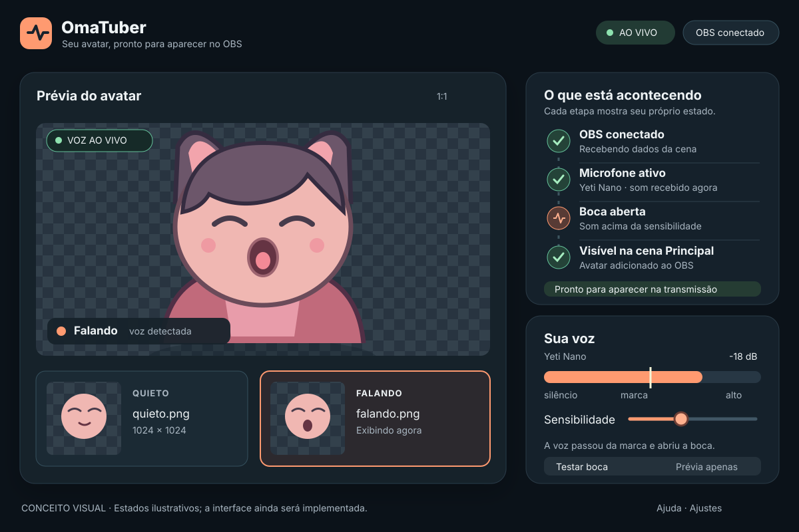

# OmaTuber — plano de implementação

## Objetivo

Criar um aplicativo de PNGTuber para Omarchy Linux que use o volume de uma fonte de áudio do OBS Studio para alternar imagens transparentes. O aplicativo configura e acompanha o avatar; uma fonte de navegador do OBS desenha o resultado na cena.

O primeiro resultado utilizável é uma gravação no OBS em que dois PNGs, com a boca fechada e aberta, alternam quando a pessoa fala. A evolução planejada aceita PNG, APNG e GIF em estados, sentimentos e objetos, com alterações aplicadas durante a transmissão. A configuração deve ser feita no aplicativo, sem acesso direto da página do avatar ao microfone ou à senha do OBS. Uma pessoa que nunca montou uma cena no OBS deve conseguir chegar ao primeiro resultado seguindo as orientações da própria interface.

## Decisões técnicas

| Peça | Escolha inicial | Motivo |
| --- | --- | --- |
| Aplicativo | Rust com `egui` e `eframe` | Interface desktop em Rust, conforme a escolha do projeto. `eframe` fornece a janela e a integração nativa de `egui`. |
| Comunicação com OBS | `obws`, com a assinatura `InputVolumeMeters` | Usa o medidor da fonte já configurada no OBS e cuida da autenticação do protocolo. |
| Tarefas em segundo plano | Tokio | Mantém a comunicação com o OBS e o servidor local fora do ciclo de desenho da interface. |
| Fonte de navegador | HTML, CSS e JavaScript servidos pelo aplicativo | O OBS recebe uma URL local estável; a página desenha PNGs sobre fundo transparente. |
| Servidor local | `axum`, escutando somente em `127.0.0.1` | Entrega a página, os dois PNGs selecionados e atualizações de estado. |
| Atualizações para a página | Server-Sent Events | O aplicativo envia mudanças de estado; a página reconecta quando o servidor volta. |

Essas bibliotecas são propostas para o primeiro protótipo. Antes de fixar versões, conferir as APIs e registrar as versões resolvidas em `Cargo.lock`. A documentação de [`eframe`](https://docs.rs/eframe/latest/eframe/), [`obws`](https://docs.rs/obws/latest/obws/) e [`axum` para SSE](https://docs.rs/axum/latest/axum/response/sse/) sustenta a viabilidade da composição; ainda não há teste integrado do OmaTuber.

## Fluxo de dados

```text
Microfone → fonte de áudio do OBS → obs-websocket
                                      ↓
                         OmaTuber: medidor e estado
                            ↙                    ↘
                    prévia no egui        servidor em 127.0.0.1
                                               ↓
                                  fonte de navegador no OBS
```

1. Depois de experimentar as imagens na prévia, a pessoa conecta o aplicativo ao OBS. A interface explica onde ativar o servidor WebSocket e encontrar a senha; a porta padrão aparece somente se a conexão precisar de ajuste. A pessoa escolhe uma fonte de áudio entre as entradas retornadas pelo OBS. A seleção deve usar o identificador da fonte, para sobreviver a mudanças de nome.
2. O aplicativo assina `InputVolumeMeters` e extrai somente os dados da fonte escolhida. O [protocolo do OBS](https://github.com/obsproject/obs-websocket/blob/master/docs/generated/protocol.md) exige a assinatura explícita desse evento; a [implementação](https://github.com/obsproject/obs-websocket/blob/master/src/eventhandler/EventHandler_Inputs.cpp) indica envio a cada 50 ms.
3. Uma pequena máquina de estados decide entre `quieto` e `falando`. Ela terá limiares distintos para abrir e fechar a boca e um tempo mínimo antes de fechar. Os valores iniciais serão ajustados com gravações reais, após conferir a semântica dos níveis entregues pelo OBS.
4. O aplicativo atualiza sua prévia e envia o estado para a página por SSE. A página troca apenas a imagem visível. Os arquivos PNG são servidos por rotas fixas; a URL não aceita caminhos de arquivos arbitrários.
5. Quando a conexão com OBS cai, o aplicativo mostra o erro e põe o avatar em `quieto`. A reconexão é automática. A página mantém o último desenho por um intervalo curto e volta ao estado `quieto` se perder as atualizações.

### Limites de segurança e configuração

- O servidor do OmaTuber escuta apenas no loopback. A porta precisa ser estável para a fonte do OBS continuar funcionando após reiniciar o aplicativo; se estiver ocupada, o aplicativo deve mostrar um erro claro antes de indicar uma URL válida.
- A página não recebe a senha do OBS. Oferecer **Lembrar neste computador** usando um serviço de segredos do Linux, se disponível; nunca gravar a senha no arquivo de preferências ou na URL. Se o serviço não estiver disponível, explicar que a senha será solicitada novamente na próxima sessão. A crate [`keyring`](https://docs.rs/keyring/latest/keyring/v1/index.html) é uma candidata a verificar na implementação.
- Na versão 0.1, o servidor entrega somente os dois PNGs escolhidos. Ao selecioná-los, o aplicativo verifica se são PNGs legíveis e impõe limites de tamanho e dimensões para evitar arquivos acidentais enormes. A expansão para APNG, GIF e biblioteca de variantes mantém rotas controladas e acrescenta limites por animação.
- Preferências sem segredo, como caminhos dos PNGs e sensibilidade, podem ser guardadas na pasta de configuração do usuário. A gravação deve ser atômica para não corromper as preferências se o processo terminar durante a escrita.

## Direção de produto: feito para o Omarchy

O OmaTuber deve entregar uma promessa simples: **escolher um avatar, ver a voz movê-lo e colocá-lo numa cena do OBS**. A referência ao estilo de produto da Apple é a disciplina de propósito, simplicidade, resposta clara e cuidado com os detalhes descrita nas [Human Interface Guidelines](https://developer.apple.com/design/human-interface-guidelines/design-principles/). A referência de plataforma é o próprio Omarchy: padrões úteis desde o primeiro uso, visual integrado ao tema e liberdade para ajustar o resultado, conforme sua [apresentação oficial](https://omarchy.org/) e seu [manual](https://omarchy.org/manual/coming-from-mac-or-windows/).

| Princípio | Decisão para o OmaTuber | Como verificar |
| --- | --- | --- |
| Começar pelo resultado | Abrir diretamente na prévia, com um avatar de exemplo utilizável. A ação principal em cada momento é a próxima necessária para chegar à cena; instruções aparecem junto do controle a que se referem. | Com o OBS fechado e sem PNGs próprios, a pessoa consegue testar a boca na primeira abertura. |
| Padrões que funcionam e podem ser alterados | Sugerir tamanho da fonte, sensibilidade e disposição inicial; permitir trocar imagens, microfone, cena e ajustes sem refazer o fluxo. Salvar escolhas locais e restaurá-las na próxima abertura. | A pessoa conclui o primeiro uso com os padrões e depois altera cada escolha sem perder a fonte já criada. |
| Estado sempre observável | Palco, miniatura ativa, medidor, modo da prévia e estado da cena vêm do mesmo estado observado. Cada falha conhecida mostra causa, consequência e uma ação de reparo perto de onde ocorreu. | Em silêncio, fala, teste manual, mudo, desconexão e fonte oculta, a pessoa consegue dizer qual imagem está em uso e se ela aparece no OBS. |
| Complexidade sob demanda | Manter a tela principal focada em avatar, voz e cena. Porta, senha, dBFS e diagnóstico técnico aparecem ao conectar, reparar ou abrir **Ajustes avançados**. O percurso guiado é retomável e não prende a pessoa antes da prévia. | Quem já configurou o app chega à prévia sem repetir etapas; quem precisa reparar uma conexão encontra o controle relevante em um passo. |
| Integração com a mesa de trabalho | Usar a paleta ativa do Omarchy, com contraste e estados legíveis também nos temas claros; acompanhar a troca de tema durante a sessão. Respeitar janelas lado a lado do Hyprland, teclado e foco visível. Instalar um lançador `.desktop` com ícone e nome pesquisável no menu de aplicativos. | Alternar entre temas claro e escuro e redimensionar a janela enquanto o app está aberto; confirmar que nenhuma ação ou texto some e que o app abre pelo menu. |
| Controle e confiança | Processar áudio e imagens localmente, explicar quando a detecção de som usa o microfone e permitir desligá-la. A ação **Adicionar avatar ao OBS** mostra cena e fonte antes de criar ou reutilizar algo; repetir a ação não duplica fontes. | Inspecionar a cena antes e depois de repetir a ação; confirmar que o app não grava áudio nem guarda a senha em preferências. |

A aparência deve dar destaque ao avatar e à ação atual: tipografia legível, poucos níveis de hierarquia, espaçamento consistente e movimento apenas para indicar mudança de estado. O tema do Omarchy fornece cores; a identidade do OmaTuber vem da prévia e dos controles próprios do produto. O [manual de temas do Omarchy](https://omarchy.org/manual/making-your-own-theme/) descreve a paleta que pode ser usada para integrar aplicativos. A leitura de `colors.toml` já existe no código, mas acontece apenas na abertura; atualização em tempo real, temas claros e contraste ainda precisam de verificação.

**Comportamento da janela durante a transmissão:** minimizar ou trocar de workspace mantém o avatar funcionando no OBS. Fechar a janela encerra o aplicativo e o servidor local, seguindo a [convenção de janelas do Omarchy](https://omarchy.org/manual/coming-from-mac-or-windows/). A interface deve dizer **Mantenha o OmaTuber aberto durante a transmissão; pode minimizá-lo** antes da primeira adição à cena. Ao reabrir o aplicativo, a fonte de navegador deve voltar a receber o avatar sem refazer a cena; a interface mostra o progresso da reconexão.

Esta direção estabelece critérios para a implementação e a revisão visual; não declara que a interface atual já os cumpre. Antes de adicionar reações e classificação de som à tela principal, concluir e observar o fluxo básico com usuários. Recursos posteriores entram onde resolvem uma tarefa comprovada, preservando o caminho curto até a primeira cena.

## Experiência de quem está começando

### Primeiro uso: do desenho à cena

O primeiro uso é uma sequência curta com avanço visível. Cada etapa tem uma ação principal, um resultado observado na prévia e uma explicação curta quando algo impede o avanço. A pessoa pode voltar sem perder as escolhas anteriores.

| Etapa | O que a pessoa vê e faz | Condição para avançar |
| --- | --- | --- |
| 1. Montar o avatar | Solta ou escolhe dois PNGs rotulados **Quieto** e **Falando**. A prévia mostra os estados lado a lado e permite alternar com um botão. Um avatar de exemplo, criado para o projeto, permite experimentar antes de ter arte própria. | As duas imagens são válidas; o exemplo também conta. |
| 2. Conectar o OBS | O aplicativo verifica se o OBS está aberto e tenta a porta local padrão. Se o servidor WebSocket estiver desligado, mostra o caminho no menu do OBS para ativá-lo. Se pedir senha, explica onde copiá-la, com campo oculto e botão de revelar. | Conexão autenticada; erro e correção aparecem na mesma tela. |
| 3. Fazer a voz reagir | Seleciona um microfone pelo nome reconhecível. Um medidor ao vivo mostra se há sinal; a pessoa fala e vê a boca mudar. Uma calibração guiada coleta alguns segundos de silêncio e fala **apenas como níveis**, sem gravar áudio. O ajuste manual fica disponível se a sugestão não funcionar. | O nível muda durante a fala e a prévia reage; se a fonte não estiver ativa na cena, a interface explica como ativá-la. |
| 4. Colocar na cena | Escolhe uma cena existente e aciona **Adicionar avatar ao OBS**. O aplicativo cria a fonte de navegador com a URL local e dimensões adequadas ao avatar, confirma o nome da fonte criada e orienta a posicioná-la na prévia do OBS. | A fonte aparece na cena escolhida; a pessoa pode fazer uma gravação curta para conferir. |

O OBS oferece a requisição [`CreateInput`](https://github.com/obsproject/obs-websocket/blob/master/docs/generated/protocol.md#createinput) e o cliente Rust [`obws` expõe `Inputs::create`](https://docs.rs/obws/latest/obws/client/struct.Inputs.html). O tipo da fonte é `browser_source`; `url`, `width` e `height` são configurações do [plugin de navegador](https://github.com/obsproject/obs-browser/blob/master/obs-browser-plugin.cpp). **A criação automática ainda precisa ser verificada no OBS local.** Antes do botão criar algo, a interface mostra a cena de destino. Se essa integração falhar, oferece **Copiar URL** com instruções de adição manual. Repetir a ação deve detectar a fonte já criada e oferecer reutilização, evitando duplicatas.

### Tela principal após a configuração

Em uma janela inicial de aproximadamente 1100 × 760 px, a área maior mostra o **PNG atualmente exibido** em um palco quadriculado. Logo abaixo, duas miniaturas mostram os PNGs carregados; a miniatura ativa recebe contorno e o texto **Exibindo agora**. A área lateral acompanha a sequência **OBS → Microfone → Boca → Cena**, cada item com seu próprio estado e ação de reparo. Em larguras menores, as áreas ficam empilhadas e roláveis, sem cortar ações.



O [mockup em SVG](ui-mockup.svg) é uma especificação visual, não uma captura do aplicativo implementado. A imagem do personagem nele é apenas um exemplo gráfico. A prévia real deve usar exatamente o PNG selecionado pela pessoa. O fundo quadriculado torna a transparência perceptível; transparência e escala finais devem ser conferidas dentro do OBS, pois a prévia usa outro renderizador.

O cartão **Avatar** troca os PNGs e oferece **Testar boca**. **Microfone** mostra o nome da fonte, o medidor e um controle de **Sensibilidade** com feedback imediato; valores em dBFS e limiares detalhados ficam em **Ajustes avançados**. **No OBS** mostra a cena e a fonte associadas, um botão para abrir o OBS quando possível e **Copiar URL** como alternativa. A senha e a porta ficam em **Conexão**, abertas apenas durante o primeiro uso ou ao reparar a conexão.

### O que a tela precisa mostrar, em tempo real

| Pergunta da pessoa | Indicação permanente | Exemplo de resposta visível |
| --- | --- | --- |
| Qual avatar carreguei? | Miniaturas **Quieto** e **Falando**, nome de cada arquivo e contorno no estado ativo; palco com o PNG real | **Exibindo agora: Falando** |
| A boca está reagindo à voz ou a um teste? | Selo de modo sobre o palco: **AO VIVO**, **TESTE MANUAL** ou **SEM OBS** | **AO VIVO · voz detectada** |
| O microfone está funcionando? | Nome da fonte, medidor animado e marca de sensibilidade no mesmo trilho | **Microfone recebendo som; acima da marca** |
| Por que a boca não abriu? | Frase curta abaixo do estado, baseada na causa conhecida | **Seu som ainda não passou da marca. Ajuste a sensibilidade.** |
| O avatar aparece na transmissão? | Estado da fonte na cena, separado do estado da prévia | **Visível na cena Principal** / **Oculto na cena Principal** / **Ainda não adicionado** |

O cabeçalho não deve dizer **Tudo pronto** apenas porque o aplicativo conectou ao OBS. Esse estado exige dois PNGs válidos, fonte de áudio ativa com níveis recentes e fonte de navegador visível na cena de destino. Quando uma dessas condições é desconhecida, mostrar **Não foi possível verificar** em vez de afirmar que está no ar. Se a cena de destino não é a cena de programa atual, mostrar **Pronto na cena Principal; outra cena está no ar**.

O modo **Teste manual** muda somente a prévia do aplicativo e exibe **Prévia apenas — não altera o OBS**. Ao sair do teste, a tela retorna ao estado calculado pelo áudio. O selo de modo, o contorno da miniatura e o texto sob o palco devem mudar juntos para evitar indicações contraditórias.

### Estados visuais e recuperação

| Situação observável | Avatar no palco | Microfone | OBS/cena | Próxima ação exibida |
| --- | --- | --- | --- | --- |
| Primeiro uso, sem imagens | Área vazia com duas posições para PNG | Aguardando configuração | Aguardando configuração | **Escolher imagens** ou **Usar exemplo** |
| Imagens prontas, OBS fechado | PNG Quieto; teste manual disponível | Sem leitura ao vivo | **OBS fechado** | **Abrir OBS** |
| OBS conectado, fonte sem eventos | PNG Quieto | **Sem sinal desta fonte**; medidor parado | Estado da cena verificado à parte | **Verificar microfone e cena ativa** |
| Fonte silenciada | PNG Quieto | **Microfone silenciado**; medidor marcado como inativo | Estado da cena verificado à parte | **Ativar microfone no OBS** |
| Nível abaixo do limiar | PNG Quieto | Barra se move antes da marca | Estado da cena verificado à parte | **Ajustar sensibilidade**, se a fala não abrir a boca |
| Nível acima do limiar | PNG Falando; miniatura Falando ativa | Barra passa da marca | Estado da cena verificado à parte | Nenhuma ação; mostrar **Sua voz abriu a boca** |
| Fonte de navegador ausente ou oculta | Prévia continua funcionando | Medidor continua funcionando | **Ainda não adicionado** ou **Oculto na cena** | **Adicionar ao OBS** ou **Mostrar fonte no OBS** |

Os estados são independentes: por exemplo, a prévia pode reagir à voz enquanto a fonte de navegador está oculta. Cor reforça a indicação, mas texto, posição e ícone a tornam compreensível sem distinguir cores. Uma animação discreta pode enfatizar a mudança de boca; ela não substitui o PNG nem mascara atrasos da entrada de áudio.

### Comportamento e linguagem da interface

- Usar palavras de tarefa na tela principal: **Quieto**, **Falando**, **Microfone**, **Sensibilidade**, **Adicionar ao OBS**. Termos como `WebSocket`, `dBFS`, `SSE` e porta aparecem apenas nas instruções de reparo ou em **Ajustes avançados**.
- Diferenciar **OBS fechado**, **servidor WebSocket desligado**, **senha incorreta**, **fonte de áudio ausente**, **fonte inativa/silenciada** e **plugin de navegador ausente**. Cada estado mostra uma próxima ação específica. Não apresentar todos como “erro de conexão”.
- Não bloquear a escolha de imagens e a simulação quando o OBS está fechado. Ao reconectar, manter avatar, fonte e sensibilidade já escolhidos.
- Ao substituir um PNG inválido, preservar o PNG anterior e explicar o problema ao lado do seletor. Mostrar nome e dimensões da imagem aceita, sem expor o caminho completo na tela principal.
- Se os dois PNGs tiverem tamanhos diferentes, avisar que a imagem pode “pular” ao falar e mostrar a alternância na prévia. Centralizar ambos na mesma área de desenho; permitir corrigir o alinhamento sem exigir que a pessoa edite os arquivos fora do aplicativo.
- Quando a calibração não separar bem fala e ruído, informar isso e oferecer o ajuste manual. A calibração não deve alterar a fonte de áudio nem os filtros do OBS.
- Suportar navegação por teclado, foco visível, rótulos de texto junto dos ícones e alvos de clique confortáveis. Usar espaçamentos consistentes e contraste legível; o visual pode acompanhar o tema do sistema, sem esconder o estado da aplicação em efeitos decorativos.

### Validação da experiência

Além da gravação técnica, observar pelo menos três pessoas com pouca experiência em OBS executarem as quatro etapas sem orientação oral. Registrar onde hesitam, quais termos não entendem e se conseguem recuperar um erro de conexão. A meta inicial é cada pessoa colocar o avatar numa cena em até dez minutos **depois de ter as imagens disponíveis**. O avatar de exemplo permite medir o fluxo sem depender de arte própria. Esse estudo está proposto, não executado; se a amostra não estiver disponível, uma revisão guiada por tarefas pode revelar problemas, mas não substitui observação de iniciantes.

## Reações e detecção do tipo de som (após a versão 0.1)

Decisão de 20 de outubro de 2026: além de abrir e fechar a boca, o avatar terá reações (rindo, surpreso, irritado, cansado, dormindo) em PNG, APNG ou GIF, disparadas pelo tipo de som e não só pelo volume. O medidor do OBS entrega apenas níveis; distinguir risada de batida na mesa exige ler o áudio. Essa é a exceção prevista no risco do medidor: a boca continua usando `InputVolumeMeters`, e só a detecção de som lê o microfone pelo PipeWire.

### Organização das imagens

| Categoria | Papel | Exemplo no modelo SrRaposaTheProgrammer |
| --- | --- | --- |
| Base | Boca × olhos; visível quando nada mais toca | Quieto, Falando, Piscando, Falando + piscando |
| Base alternativa | Outro conjunto completo, com animação de entrada | Café, com a sequência de beber |
| Sentimentos e reações | Trocam a expressão ou substituem o avatar por um tempo | Rindo, Surpreso, Irritado, Cansado, Dormindo, Sarcástico, Focado |
| Objetos e efeitos | Aparecem como camadas presas ao avatar ou em pontos de overlay | Caneca, óculos, !, ?, Zzz, brilho |
| Roupas | Bases alternativas, opcionais | Moletom, camisa |

Cada reação define gatilho, destino, prioridade, comportamento ao terminar (voltar à base, repetir enquanto a condição durar ou ficar até o próximo atalho) e um objeto ou efeito opcional que toca junto. Empates de prioridade favorecem a reação mais recente. Toda reação também responde a `omatuber reagir <nome>`, para ser associada a um `bind` do Hyprland. Objetos presos ao avatar aparecem na mesma fonte de navegador; pontos de overlay que precisam ser posicionados separadamente usam uma fonte adicional com rota estável (`/overlay/<ponto>`), criada uma vez. Repetir uma reação precisa reiniciar seu APNG ou GIF desde o primeiro quadro.

### Variações editáveis durante o uso

Tratar **sentimento** como o nome de uma expressão escolhida pela pessoa (por exemplo, **Animado**) e **objeto** como uma camada visual (por exemplo, **Caneca**). Um mesmo item pode ter variantes com imagens diferentes, como caneca cheia/vazia ou animado quieto/falando. Cada variante tem um identificador estável, nome, arquivo, posição/escala, regra de repetição e condições de entrada/saída. A pessoa pode criar, duplicar, renomear, substituir, desativar e remover itens na biblioteca, testar a combinação na prévia e aplicar a mudança sem reiniciar o app. Um item ausente ou inválido mantém a última versão válida em uso e mostra o erro no editor.

Os gatilhos são independentes das imagens: atalho ou botão manual, duração/silêncio e classe de som treinada localmente. Treinar uma classe de áudio significa associar **um som demonstrado pela pessoa** a uma reação; o classificador não deve afirmar que deduziu o sentimento real da pessoa nem que reconheceu visualmente um objeto. Objetos sem assinatura sonora confiável continuam acionáveis manualmente. A interface mostra **Acionado por voz**, **Atalho** ou **Teste** junto da variação ativa e permite desativar cada gatilho.

Ao adicionar ou corrigir exemplos de áudio, treinar um novo modelo em segundo plano, avaliá-lo contra exemplos guardados e trocar o modelo ativo apenas se o treino terminar e a pessoa aceitar o resultado. Durante o treino, o avatar e o modelo anterior continuam funcionando. Classes novas precisam de exemplos positivos e da classe `outros`; quando faltarem exemplos ou houver muita confusão, sugerir o gatilho manual e deixar a classe sem disparo automático. Guardar exemplos e configuração localmente, com IDs independentes dos nomes exibidos; salvar mudanças de forma atômica e permitir desfazer uma edição ainda não aplicada.

O estado publicado pelo OmaTuber inclui base, sentimento, objetos ativos, variantes e uma revisão de configuração. A prévia e as fontes de navegador consomem essa mesma composição. Uma mudança de arquivo, posição, regra ou modelo aplicada no editor publica uma nova revisão por SSE e aparece na cena existente sem recriar a fonte do OBS. Se um arquivo for editado fora do app, oferecer **Recarregar arquivo**; detecção automática de alterações pode ser adicionada depois, desde que nunca exponha um arquivo parcialmente escrito. Prioridade, exclusão mútua e retorno à base são resolvidos antes do envio, para que a prévia e o OBS mostrem a mesma combinação.

### PNG, APNG e GIF

Aceitar os três formatos tanto nos estados Quieto/Falando quanto nas variantes, reações e objetos. Identificar o formato pelos bytes, distinguir PNG estático de APNG e validar todos os quadros, duração, dimensões, quantidade de quadros e custo de memória antes de aplicar uma imagem. A prévia precisa reproduzir a animação com tempo, transparência e regra de repetição equivalentes aos da página do OBS; decodificar só o primeiro quadro serve apenas para miniatura. Arquivos animados recebem limite próprio de recursos, além do limite atual de 16 MiB por arquivo e 4096 px por lado, a definir com testes de uso real.

Servir os bytes validados com tipo correto (`image/png`, `image/apng` ou `image/gif`) por rotas baseadas em IDs conhecidos pelo app; nunca aceitar um caminho arbitrário vindo da URL. Usar URL com revisão para carregar uma substituição sem cache antigo. Para uma reação que deve começar do início, criar uma nova instância da imagem ou trocar sua URL a cada disparo; apenas ocultar e mostrar o mesmo elemento pode deixar a animação no meio. Base animada pode repetir continuamente; uma reação de execução única volta à base ao terminar, segundo a duração validada. O [GIF oferece transparência limitada a pixels inteiramente transparentes](https://developer.mozilla.org/en-US/docs/Web/Media/Guides/Formats/Image_types), então a interface pode recomendar APNG quando o contorno ficar serrilhado.

A [fonte de navegador do OBS](https://obsproject.com/kb/browser-source) usa CEF, aceita URL local e página transparente; isso sustenta a arquitetura, mas a reprodução exata de APNG/GIF, descarte de quadros e reinício da animação ainda precisam ser medidos no OBS instalado. A crate [`image` expõe decodificadores de animação para APNG e GIF](https://docs.rs/image/latest/image/trait.AnimationDecoder.html), com a feature `gif` necessária para GIF; a implementação atual usa apenas PNG estático. Testar a página no OBS com as opções **Desligar fonte quando não visível** e **Atualizar navegador quando cena se torna ativa** em ambas as posições, pois podem reiniciar a página e a animação.

### Detecção

Classificador principal (decisão de 20 de outubro de 2026): **Naive Bayes gaussiano treinado com a voz da própria pessoa**, em Rust puro (`src/sound.rs`). A cada 0,25 s, uma janela de 0,5 s vira 36 características: forma do espectro em 24 faixas mel (relativa à média da janela), volume (média, desvio, amplitude e maior subida), cruzamentos por zero, centroide e planicidade espectral, ritmo do envelope de 4 a 10 Hz (risada tem ~4–6 sílabas por segundo), fração de quadros com tom de voz e altura média da voz. Janelas abaixo de −50 dBFS são silêncio e não são classificadas. As classes têm priores iguais; como as características são correlacionadas, as log-verossimilhanças são divididas por uma temperatura (6) antes de virarem probabilidades. Uma reação dispara quando a mesma classe é a mais provável, com p ≥ 0,7, em 2 janelas seguidas; `fala` e `outros` competem mas nunca disparam. Vantagens: alguns KB, sem modelo baixado, janela menor que a do YAMNet e personalizado. Limite: confunde sons que a pessoa não ensinou, por isso a classe `outros` (teclado, cliques, música) é parte do treino.

Comparação: YAMNet, rodando os mesmos clipes por `tools/yamnet/compare.py`. Descrição do modelo:

[YAMNet](https://github.com/tensorflow/models/tree/master/research/audioset/yamnet), classificador de eventos sonoros treinado no AudioSet, com 521 classes, entrada de 16 kHz mono e cerca de 3,7 milhões de pesos. A [lista de classes](https://github.com/tensorflow/models/blob/master/research/audioset/yamnet/yamnet_class_map.csv) inclui as usadas aqui: Laughter, Giggle, Snicker, Belly laugh e Chuckle (risada); Gasp e Screaming (susto); Shout, Yell e Bellow (grito); Sigh e Groan (suspiro). Não há classe de bocejo nem de surpresa falada; **Dormindo** continua por silêncio longo.

- **Atraso:** o modelo precisa de pelo menos 975 ms de áudio para a primeira saída; a reação chega de 0,5 a 1 s depois do som. Aceitável para risada e suspiro; para susto, avaliar se o atraso tira o efeito.
- **Precisão:** o README publica mAP balanceado de 0,306 no conjunto de avaliação do AudioSet. Isso não diz como o modelo se sai com a voz e o microfone de uma pessoa; a decisão depende do teste abaixo.
- **Execução em Rust:** converter o modelo para ONNX e rodar em CPU, numa tarefa separada da interface. Verificar `tract-onnx` (Rust puro) e `ort` (ONNX Runtime) quanto a compatibilidade e uso de CPU. Confirmar a licença dos pesos antes de distribuí-los.
- **Captura:** ler o mesmo microfone pelo PipeWire, com reamostragem para 16 kHz. Filtros do OBS, como supressão de ruído, não se aplicam a essa leitura.
- **Privacidade:** o áudio passa pelo modelo na memória e é descartado; nada é gravado nem enviado. A interface diz isso ao lado do seletor de microfone. A detecção começa desligada e é ligada pela pessoa.

### Prova antes de construir

Gravar, com consentimento e só localmente, alguns minutos da própria pessoa falando, rindo, arfando, gritando e suspirando, mais ruídos comuns (teclado, batidas, música de fundo). Para cada som, medir em quantos trechos o modelo acerta e quantos disparos falsos ocorrem em 10 minutos de fala comum. **Avançar quando** risada e grito forem reconhecidos na maioria dos casos sem disparos falsos frequentes; caso contrário, manter essas reações por atalho e rever o modelo.

### Entrega das variações após a versão 0.1

1. Implementar carregamento e prévia animada de PNG, APNG e GIF, mantendo os dois estados básicos e a URL atual da fonte. Validar transparência, duração e reinício em gravação do OBS antes de habilitar os formatos animados na interface principal.
2. Introduzir biblioteca local de sentimentos e objetos, composição por camadas e edição ao vivo. Confirmar que trocar um arquivo ou posição modifica a cena já aberta sem duplicar fontes ou exigir atualização manual no OBS.
3. Integrar o treinamento local ao editor, com exemplos por classe, avaliação visível, aceitação do novo modelo e troca sem interromper a cena. Testar acréscimo, correção e remoção de uma classe enquanto o avatar está no OBS.
4. Validar juntos prévia, OBS, atalhos e detecção para combinações concorrentes, cena oculta/reativada, reconexão do SSE e reinício do aplicativo. Concluir quando uma pessoa conseguir criar uma variação de sentimento e um objeto, ligá-los a gatilhos e alterá-los durante uma gravação sem refazer a cena.

## Etapas e critérios de conclusão

### 1. Prova da integração com OBS

- Verificar se o OBS local oferece a fonte de navegador. Nesta máquina, OBS 32.2.2, `obs-websocket` e o pacote Arch [`obs-studio-plugin-browser`](https://archlinux.org/packages/extra/x86_64/obs-studio-plugin-browser/) estão instalados; falta validar a fonte numa cena real.
- Conectar um cliente Rust ao `obs-websocket` com autenticação e listar as fontes de áudio.
- Registrar amostras dos eventos de volume durante silêncio, fala e microfone silenciado, sem gravar áudio. Confirmar qual valor do evento é adequado para a decisão de abrir a boca.
- **Avançar quando:** a fonte escolhida puder ser identificada e seus eventos chegarem continuamente em uma sessão real do OBS.

### 2. Aplicativo e imagens

- Criar a janela com `eframe`, escolha de dois PNGs, prévia, sensibilidade e mensagens de erro compreensíveis. Acrescentar o fluxo inicial em etapas, um avatar de exemplo com licença definida e os estados visuais do [mockup](ui-mockup.svg).
- Implementar a máquina de estados separada da interface, com testes para silêncio, fala perto do limiar, oscilações e perda da fonte.
- Fazer os indicadores de modo, miniatura ativa, PNG no palco, medidor e texto de causa consumirem o mesmo estado observado pela interface. O teste manual deve declarar que afeta somente a prévia.
- Completar a integração visual com o Omarchy: reagir à troca de tema, verificar contraste nos temas claro e escuro e manter a tela utilizável em janela estreita e com navegação por teclado.
- Incluir no empacotamento um arquivo `.desktop` e um ícone próprios para abrir o app pelo menu do Omarchy.
- **Avançar quando:** imagens e estado mudarem corretamente na prévia, inclusive no modo de simulação, o primeiro uso puder começar com o OBS fechado e nenhuma indicação **AO VIVO** permanecer após perda de conexão.

### 3. Fonte de navegador

- Servir a página transparente e os PNGs por HTTP local; enviar o estado por SSE.
- Criar a fonte de navegador na cena escolhida após o clique da pessoa; oferecer a URL e a adição manual se o OBS recusar a criação. A [fonte de navegador do OBS](https://obsproject.com/kb/browser-source) aceita URL e fundo transparente.
- **Avançar quando:** a fonte aparecer sobre outra imagem no OBS, sem retângulo opaco, acompanhar as mudanças feitas no aplicativo e não ser duplicada quando a ação for repetida.

### 4. Verificação de uso real

- Gravar no OBS sessões curtas com silêncio, fala normal, pausas, microfone silenciado, troca de fonte e reinício do aplicativo.
- Inspecionar visualmente as gravações e medir o intervalo entre início da fala e abertura da boca. Usar 250 ms como limite inicial para 95% das transições observadas; revisar esse limite se a cadência de 50 ms do medidor ou o processamento do OBS o tornar inadequado, registrando o motivo.
- Conferir que 30 segundos de silêncio não produzam aberturas falsas e que a fonte se recupere após reiniciar o aplicativo.
- Conferir visualmente as combinações da tabela **Estados visuais e recuperação**. Em especial, ocultar a fonte no OBS enquanto a voz continua ativa: a prévia deve continuar reagindo, e o estado **Visível na cena** deve desaparecer.
- Executar as tarefas de primeiro uso e reparo com iniciantes, conforme a seção de validação da experiência; revisar os pontos de hesitação antes de considerar a interface pronta.
- Conferir o percurso pelo lançador do Omarchy, a troca de tema com o app aberto, a continuidade da fonte ao minimizar e a perda da fonte ao encerrar o app. A explicação sobre manter o aplicativo aberto deve aparecer antes de adicionar a fonte à cena.
- **Concluir a versão 0.1 quando:** a gravação mostrar transparência correta, resposta estável à fala e recuperação de uma desconexão sem refazer a configuração da cena, e o fluxo guiado permitir colocar o avatar no OBS sem recorrer a instruções externas.

## Riscos que podem mudar o plano

| Risco | Verificação decisiva | Resposta prevista |
| --- | --- | --- |
| A fonte de navegador não está disponível ou falha na instalação local | Criar uma fonte vazia no OBS após instalar o pacote correspondente | Resolver o empacotamento do OBS antes de desenvolver a sobreposição. |
| O medidor não representa a fala como esperado, especialmente após filtros ou mudo | Comparar eventos com o medidor e com uma gravação do OBS | Ajustar a fonte ou o valor lido; considerar captura via PipeWire apenas se o medidor do OBS se mostrar inadequado. |
| A cadência dos eventos produz animação perceptivelmente atrasada | Medir transições numa gravação, conforme a etapa 4 | Ajustar limiares e tempo de fechamento; avaliar outra origem de áudio se persistir. |
| O aplicativo fecha e a fonte perde a URL | Reiniciar o aplicativo com a fonte já configurada no OBS | Manter porta estável e reconexão automática; mostrar estado de espera na interface. |
| A criação automática da fonte falha ou cria duplicatas | Executar a ação duas vezes e repetir após renomear ou trocar de cena | Detectar fontes associadas, oferecer reutilização e manter a opção de adição manual. |
| O classificador de som erra com a voz da pessoa ou dispara com ruídos | Medir acertos e disparos falsos em gravações próprias, conforme a prova da detecção | Ajustar a confiança mínima por som; deixar a reação apenas por atalho se não houver ajuste aceitável. |
| APNG ou GIF toca em tempo diferente na prévia e no OBS, ou reinicia em momento errado | Gravar disparos repetidos, troca de cena e edição de arquivo nos três formatos | Corrigir a lógica de quadros e de reinício; manter o formato fora da interface principal até a gravação confirmar o comportamento. |
| Uma edição ao vivo deixa prévia e OBS com versões diferentes | Trocar imagens, objetos e modelo durante uma gravação e interromper uma gravação de arquivo no meio | Publicar revisões completas e validadas; conservar a revisão anterior quando a nova falhar. |
| O fluxo parece claro para quem já conhece OBS, mas trava um iniciante | Observar as quatro tarefas com pessoas pouco experientes | Reescrever instruções e mudar a ordem das ações nos pontos em que houver hesitação. |

## Estado da validação

Este plano se baseia em documentação oficial de OBS e das bibliotecas Rust, na inspeção do repositório (que começou apenas com o README) e numa checagem de pacotes instalados nesta máquina em 20 de outubro de 2026. **Nenhuma etapa de integração ou gravação foi executada ainda.** A primeira prova com o OBS é o ponto de decisão antes de investir na interface completa.

### Registro de execução

**2026-10-20, iteração 1.** Verificado na fonte, sem OBS em execução:

- `obs-websocket` (`src/utils/Obs_VolumeMeter.cpp`, master): cada canal de `inputLevelsMul` é `[RMS × volume, pico × volume, pico bruto]`, em multiplicador linear. Mudo zera os dois primeiros; o terceiro ignora mudo e volume e não serve para a boca. Os valores vêm do último bloco de áudio antes do tick de 50 ms, não de uma média do intervalo, e zeram após 0,3 s sem áudio. Só fontes ativas (`obs_source_active`) aparecem no evento: um microfone fora da cena atual some do fluxo.
- `obws` 0.15.0: `InputVolumeMeter` expõe apenas `inputName`, não `inputUuid`. A seleção continua guardando o UUID; o nome correspondente é resolvido por `GetInputList` e atualizado pelo evento `InputNameChanged`.
- Configuração local do `obs-websocket`: `server_enabled: false`. É preciso ativar o servidor no OBS (Ferramentas → Configurações do servidor WebSocket) antes da etapa 1. Nesse momento da iteração, o pacote `obs-studio-plugin-browser` ainda estava ausente.

Implementado: `src/meter.rs` (conversão para dBFS usando só valores após volume/mudo), `src/mouth.rs` (histerese, retenção e expiração, com testes) e `src/bin/obs-probe.rs` (`list` e `record <uuid> [s]`, saída CSV). Os limiares padrão (-30/-38 dBFS, retenção de 150 ms) são provisórios. A sonda ainda não rodou contra um OBS real.

**2026-10-20, iteração 2.** OBS aberto e `obs-studio-plugin-browser` instalado, mas a porta 4455 não escuta: o servidor WebSocket continua desligado, e a etapa 1 segue pendente.

Etapa 2, parcial: janela `eframe` 0.37 (a API agora usa `App::ui(&mut Ui, …)`, não `update`) com seções **Áudio** e **Avatar**. `src/avatar.rs` lê cada PNG uma vez, rejeita arquivos acima de 16 MiB, formatos que não sejam PNG e imagens acima de 4096 px por lado antes de decodificar; os mesmos bytes serão servidos na etapa 3. O seletor usa `rfd` pelo xdg-desktop-portal numa thread separada. A sensibilidade é um controle único (fechar = abrir − 8 dB), com medidor e marcas dos dois limiares. A simulação alimenta a máquina de estados a cada 50 ms, como o OBS. Verificado: compilação sem avisos do clippy, 26 testes e abertura da janela no Hyprland. Não verificado: escolha de arquivo e simulação por interação real. Faltam as seções **Conexão OBS** e **Saída OBS**.

**2026-10-20, revisão de UI/UX.** O plano passou a definir um primeiro uso guiado, prévia antes da conexão com OBS, linguagem voltada à tarefa, calibração assistida, criação da fonte na cena escolhida e critérios de observação com iniciantes. Essas são decisões de projeto; a janela atual ainda mostra as seções técnicas parciais descritas na iteração 2.

**2026-10-20, revisão dos estados visuais.** Adicionado o [mockup conceitual](ui-mockup.svg) e uma matriz de estados para tornar visíveis o PNG carregado, a imagem exibida agora, a origem da prévia, o motivo da posição da boca, o sinal do microfone e a visibilidade da fonte no OBS. O mockup foi renderizado e inspecionado; a interface real ainda precisa implementar e validar esses comportamentos.

**2026-10-20, iteração 3.** A configuração do `obs-websocket` agora tem `server_enabled: true`, mas o OBS estava fechado; a sonda ainda não rodou contra ele.

Etapa 3, parcial: `src/server.rs` com `axum` 0.8 em `127.0.0.1:39017`. Rotas fixas `/`, `/closed.png`, `/open.png` e `/events`; outros caminhos dão 404. Os PNGs são os bytes validados na escolha, sem cópia (`Arc<[u8]>`), com `Cache-Control: no-store` e `?rev=` para invalidar o cache da página. O SSE envia imagens e estado ao conectar, cada mudança e um reenvio do estado por segundo. A página (`src/page.html`) fecha a boca em erro de conexão ou após 3 s sem mensagens. O app só mostra a URL depois de conseguir a porta; se estiver ocupada, mostra o erro e um botão para tentar de novo.

Verificado: 34 testes (rotas, 404 fora das rotas fixas, sequência SSE com relógio simulado, porta ocupada, bind só em loopback) e execução real (página 200, `/events` com estado inicial e reenvio a cada segundo, segunda instância aberta sem derrubar a primeira). Não verificado: a mensagem de porta ocupada na tela, a página dentro do OBS e a transparência.

**2026-10-20, iteração 4.** OBS fechado; a conexão real continua sem teste.

Seção **Conexão OBS** implementada em `src/obs.rs`. A máquina de estados saiu da interface para uma tarefa Tokio, porque o `eframe` não chama `App::ui` com a janela oculta e a fonte do OBS precisa continuar animando com o app minimizado. A tarefa recebe comandos da interface (conectar, desconectar, escolher fonte, sensibilidade, simulação), publica o estado para a interface e para o servidor e verifica o estado a cada 50 ms. Reconexão automática com espera de 1 s dobrando até 10 s; senha recusada (código 4009) não repete as tentativas. A lista de fontes é refeita em `InputCreated`, `InputRemoved` e `InputNameChanged`.

Defeito encontrado no `obws` 0.15 (`events.rs`, `EventStream::poll_next`): um `Lagged` do canal broadcast é convertido em `None` e, com `fuse()`, encerra o stream de eventos para sempre com a conexão ainda aberta. Mitigação: o fim do stream é tratado como desconexão e dispara a reconexão, e o buffer de eventos subiu de 100 para 1024.

Verificado: 38 testes, incluindo recusa de conexão com nova tentativa agendada e um teste de integração por TCP real em que a simulação chega à página como `data: open` e volta a `data: closed`. Não verificado: conexão, autenticação e medidores com o OBS real; interface desta versão não foi aberta.

**2026-10-20, iteração 5.** OBS fechado.

Preferências em `src/prefs.rs`: porta do OBS, UUID da fonte de áudio, sensibilidade e caminhos dos PNGs, em `$XDG_CONFIG_HOME/omatuber/prefs.json` (ou `~/.config`). A senha não é gravada. A escrita é atômica: arquivo temporário na mesma pasta, `fsync`, `rename` e `fsync` da pasta. Arquivo ausente usa os padrões; arquivo inválido gera um aviso na janela e não é sobrescrito até a pessoa mudar alguma configuração. O app salva quando algo muda, exceto durante o arraste de um controle. Na abertura, os PNGs salvos são recarregados e validados; um arquivo ausente mostra erro, mas o caminho continua salvo.

Verificado: 43 testes (5 novos para ida e volta, campos ausentes, arquivo corrompido, sobrescrita e ausência de arquivo temporário). Não verificado: o fluxo de salvar e reabrir pela interface.

**2026-10-20, iteração 6.** OBS fechado. Interface refeita depois da crítica de que estava ruim de usar: a janela anterior era uma coluna de seções na ordem dos módulos, com jargão ("dBFS"), prévia de 256 px de uma imagem só e simulação por caixa de seleção mais controle deslizante.

Nova organização (`src/view.rs`, sem E/S, devolve ações para `main.rs`): faixa de estado no topo (OBS, microfone, copiar URL), com cor por situação; painel de conexão que abre no início da sessão e em erro e se recolhe ao conectar; as duas imagens lado a lado sobre fundo xadrez, com a imagem ativa destacada, clique ou arraste para trocar; medidor com a linha de sensibilidade arrastável sobre a própria barra; botão "Segure para testar". Cores lidas do tema ativo do Omarchy em `~/.local/state/omarchy/current/theme/colors.toml` (o caminho `~/.config/omarchy/current/theme`, citado antes sem conferir, não existe nesta máquina).

Verificação visual por renderização fora da tela com `egui_kittest` (`cargo run --example render_view -- <pasta>`), em quatro cenas: primeira abertura, falando, janela estreita e erros. As capturas mostraram e permitiram corrigir: rótulo "Microfone" cortado na janela estreita; mensagem de erro longa alargando o conteúdo além da janela; borda de "ativo" em cartão vazio; o glifo "→", ausente da fonte padrão; e quatro controles sem nome acessível (senha, porta, seletor de fonte, faixas de estado). Verificado: 51 testes, 6 deles de interação pela árvore de acessibilidade. Não verificado: janela real, arrastar arquivo no Wayland (posição do cursor durante o arraste), botão de teste pressionado e arraste da linha de sensibilidade.

**2026-10-20, iteração 7.** OBS fechado. Verificação parcial da etapa 3 num navegador real, usando o Chromium do sistema em modo sem interface (a fonte de navegador do OBS também usa Chromium, via CEF, mas versão e configuração diferem).

`examples/serve_demo.rs` serve a página com dois PNGs gerados e alterna a boca por tempo. Captura direta com `--default-background-color=00000000`: cantos com alfa 0, rosto opaco, sem retângulo de fundo e sem barras de rolagem. Troca pelo SSE: o `--screenshot` do Chromium captura no evento `load`, antes de qualquer atualização (a primeira tentativa deu duas imagens iguais por isso, não por falha da página). Com uma página externa que segura o `load` por 3 s e alternância aos 2 s, a captura mostrou a boca aberta: pixels escuros da boca foram de 774 para 3701. Não verificado: a página dentro do OBS, com sua escala e transparência.

**2026-10-20, design de reações.** Definidos, no canvas de UI/UX, a biblioteca de reações por categoria, os pontos de overlay no OBS e a tela de detecção de som, usando o modelo SrRaposaTheProgrammer. Decidido detectar o tipo de som pelo PipeWire com um classificador local (seção **Reações e detecção do tipo de som**). Nada disso foi implementado; a lista de classes do YAMNet foi conferida no repositório oficial, mas o modelo não rodou nesta máquina.

**2026-10-20, prova do classificador de som.** Decidido usar Naive Bayes treinado com a voz da pessoa e manter o YAMNet só como comparação (seção **Detecção**). Implementado atrás da feature `sound` do Cargo, sem afetar o build padrão: `src/sound.rs` (características, classificador, validação "deixa um clipe de fora" e detector com confirmação), `src/capture.rs` (captura pelo PipeWire pedindo F32LE 16 kHz mono; o PipeWire faz a reamostragem) e `src/bin/sound-probe.rs` (`levels`, `record`, `train`, `live`, `classify`). Os exemplos ficam em `~/.local/share/omatuber/sounds/<classe>/` como WAV 16 kHz e não saem do computador. O YAMNet foi exportado para ONNX a partir do código e dos pesos oficiais (`tools/yamnet/export.py`; só a rede, com o log-mel calculado em NumPy por `tools/yamnet/compare.py`); ONNX e TensorFlow diferem em no máximo 2×10⁻⁶ nas pontuações, e o log-mel em NumPy difere do TensorFlow em até 1,9×10⁻⁴. O modelo exportado fica em `models/`, fora do git.

Verificado: 9 testes novos (filtros mel, porta de silêncio, altura de voz numa dente de serra de 200 Hz, ritmo de ruído pulsado a 5 Hz, separação tom × chiado, JSON, confirmação do detector), clippy limpo com e sem a feature e 53 testes passando. A captura funcionou pelo microfone embutido, com o formato confirmado no `pw-dump`; o nível medido (cerca de −10 dB RMS, picos em 0 dB) bate com o `pw-record`, ou seja, esse microfone está saturando. O fluxo completo rodou com dados de teste (7 frases do espeak-ng, 6 ruídos sintéticos e 3 clipes ambientes gravados pelo `record`): Bayes acertou 15 de 16 clipes na validação "deixa um de fora" e classificou como fala uma frase fora do treino; o YAMNet também acertou 15 de 16 (ruído ambiente de um clipe virou fala). **Não verificado:** risada, susto, grito e suspiro reais; esses números dizem só que o encadeamento funciona. A próxima etapa é gravar a voz da pessoa e comparar os dois classificadores nos mesmos clipes.

**2026-10-20, iteração 8: tela principal conforme o mockup.** OBS fechado.

`src/view.rs` refeito no desenho de `docs/ui-mockup.svg`: cabeçalho com selo de modo; **Prévia do avatar** com palco quadriculado mostrando o PNG exibido, selo no canto e legenda (**Falando · voz detectada**), e miniaturas **Quieto/Falando** com nome, dimensões e **Exibindo agora**; coluna **O que está acontecendo** (OBS → Microfone → Boca → Cena), cada item com estado e ação; cartão **Sua voz** com seletor de microfone, medidor com marca arrastável, **Sensibilidade** de 0 a 100, frase de causa e **Segure para testar a boca**. Abaixo de 860 px as áreas empilham. Porta e limiares em dBFS foram para **Ajustes avançados**.

Regras do plano agora no código: um único `Mode` (TESTE MANUAL, AO VIVO, SEM SINAL, SEM OBS) alimenta selo, palco, miniatura ativa e frase de causa. **AO VIVO** exige conexão, fonte existente na lista do OBS e níveis recentes (`Status::receiving`, novo, vindo da tarefa do OBS); perder a conexão leva a **SEM OBS** e à boca fechada. O teste manual deixou de enviar `Simulate` ao OBS: só muda a prévia, como o plano pede. A cena ainda não é consultada, por isso o item **Cena** mostra **não verificado** e nada afirma **Tudo pronto**. Avatar de exemplo (`src/example.rs`): raposa desenhada em código, com bordas suavizadas, gravada em `~/.local/share/omatuber/example/` e carregada como PNG comum; licença do próprio projeto.

As capturas fora da tela (`cargo run --example render_view`, 7 cenas) mostraram e permitiram corrigir: conteúdo da coluna esquerda disposto na horizontal (`allocate_ui` herdava o layout de `horizontal_top`); miniaturas por cima do palco no primeiro uso (`scope_builder` movia o cursor; trocado por `new_child`). Os testes de estado acharam AO VIVO com fonte salva inexistente; corrigido. Verificado: 59 testes (68 com `sound`), 10 de interface. Não verificado: janela real, arrastar arquivo no Wayland, teste segurado pelo mouse e os estados com OBS real.

**2026-10-20, direção de produto.** Registrados os princípios de integração com o Omarchy e de clareza de interface inspirados nas Human Interface Guidelines da Apple. São critérios para o trabalho seguinte, sem nova implementação ou validação do aplicativo nesta revisão.

**2026-10-20, expansão planejada de variações e formatos.** Especificadas variantes editáveis de sentimentos e objetos, treinamento local com troca segura do modelo, atualização da fonte de navegador durante a transmissão e suporte planejado a PNG, APNG e GIF. O código atual continua limitado aos dois PNGs estáticos; esta revisão é apenas do plano.

**2026-10-21, iteração 9: tempo real e integração com o Omarchy.** OBS fechado.

*Tempo real.* `examples/bench_sound.rs` mede o analisador de som em 60 s de áudio sintético com voz e ruído (i5-1135G7, mediana de 5 rodadas de 238 janelas): **7,0 ms por janela em release, com uma janela a cada 250 ms, ou 2,8 % de um núcleo**. O cálculo não é o gargalo; o atraso de uma reação vem da janela de 0,5 s, do salto de 0,25 s e da confirmação em 2 janelas. Reduzir o salto para 125 ms custaria cerca de 5,6 % de um núcleo e encurtaria a confirmação, mas pode aumentar disparos falsos; fica como hipótese até haver gravações reais. O build de desenvolvimento gastava 67 ms por janela (27 %); com dependências otimizadas no perfil `dev`, 7,3 ms, ao custo de uma compilação completa de cerca de 8 min, uma vez, e 9,7 s por recompilação incremental da interface. O primeiro commit dessa mudança quebrou `cargo test` sem a feature `sound` (o exemplo não declarava a feature); corrigido em seguida.

*Tema.* Medido o contraste WCAG nos 22 temas de `/usr/share/omarchy/themes` e no atual: o `muted` dos temas, que eu usava como texto secundário, fica abaixo de 4,5:1 em 20 de 23 (de 1,5 a 2,5 na maioria), e vermelho, amarelo e verde como texto falham em vários. Alguns temas trocam essas cores (matte-black: `yellow = #b91c1c`, `green = #FFC107`), o que inverteria o sentido dos ícones de estado. `src/theme.rs` agora: usa a base clara do egui em `mode = "light"`; sobe `muted` em direção ao `foreground` até 4,5:1; aceita a cor de estado do tema só na faixa de matiz esperada, senão usa uma padrão, e ajusta seu contraste misturando com preto ou branco, o que mantém o matiz; escolhe a cor do texto nos botões de destaque (`on_accent`) com pelo menos 4,5:1. Um teste percorre todos os temas instalados. O app relê o `colors.toml` a cada segundo e reaplica o tema quando o conteúdo muda.

*Lançador.* `packaging/omatuber.desktop` (validado com `desktop-file-validate`), ícone `packaging/omatuber.svg` e `packaging/install-local.sh` (`cargo install` e cópia para `~/.local/share`). O aviso **Mantenha o OmaTuber aberto durante a transmissão; pode minimizá-lo** aparece junto de **Copiar URL**, antes de a fonte ser adicionada.

Verificado: 64 testes, clippy limpo com e sem `sound`, capturas fora da tela nos temas catppuccin-latte, rose-pine e matte-black. Não verificado: a troca de tema com a janela real aberta, o lançador instalado e aberto pelo menu, e o foco por teclado. Visto nas capturas: no tema claro, o quadriculado do palco fica pouco visível.

**2026-10-21, iteração 10: quadriculado e animações (entrega 1 das variações).** OBS fechado.

O quadriculado do palco usa agora uma cor derivada com pelo menos 1,25:1 sobre o fundo; no catppuccin-latte, as duas cores de fundo do tema ficavam a 1,03:1 e escondiam a transparência. Testado em todos os temas instalados.

`src/avatar.rs` passou a aceitar PNG, APNG e GIF, identificados pelos bytes. Os quadros vêm compostos pelo `image` 0.25 (descarte e mistura aplicados). Limites verificados a cada quadro durante a decodificação, para falhar cedo: 600 quadros, 256 MiB decodificados, 60 s por volta, além dos 16 MiB e 4096 px que já valiam; valores iniciais, a rever com avatares reais. Atrasos de até 10 ms viram 100 ms, a mesma regra do Chromium, conferida na fonte (`third_party/blink/renderer/platform/graphics/deferred_image_decoder.cc`, `FrameDurationAtIndex`, branch main). A prévia anima o palco pelo relógio da interface e só repinta quando o quadro muda; as miniaturas mostram o primeiro quadro. O servidor mantém as rotas `/closed.png` e `/open.png`, para a URL da cena não mudar, e envia `image/png`, `image/apng` ou `image/gif` conforme o arquivo.

Seguindo a entrega 1, os formatos animados **não estão liberados na interface principal**: um APNG ou GIF escolhido é recusado com a explicação "animações ainda estão em teste", e o avatar anterior continua. Para testar, abrir o app com `OMATUBER_ANIMATED=1`.

Verificado: 74 testes, entre eles decodificação de APNG e GIF com atrasos e transparência, limites, laço de quadros, escolha de quadro na prévia e tipo servido. No Chromium sem interface, um GIF de dois quadros de 1 s servido por `/closed.png` mostrou o vermelho aos 0,3 s e o azul aos 1,3 s, com a faixa transparente preservada. O primeiro GIF de teste estava errado (o PIL marcou o vermelho como cor transparente da paleta); o Chromium o desenhou fielmente, e o arquivo foi refeito. **Não verificado**: reprodução e reinício no OBS (CEF), opções da fonte "Desligar quando não visível" e "Atualizar ao ativar a cena", e se a prévia e o OBS ficam no mesmo quadro ao alternar a boca. A página mantém as duas imagens carregadas e alterna a visibilidade, então cada uma segue o próprio relógio; a prévia faz o mesmo, a partir da hora em que o arquivo foi carregado. Essa equivalência depende de como o OBS trata animações ocultas e precisa ser medida.

**2026-10-21, iteração 11: modelo da biblioteca (entrega 2, parte 1).** OBS fechado.

`src/library.rs`: biblioteca de **sentimentos** (expressão escolhida pela pessoa, com imagem quieta e, opcionalmente, falando; prioridade; término após um tempo ou só no próximo acionamento; objetos que entram junto) e **objetos** (camada com posição e escala relativas ao avatar). IDs são UUIDs estáveis, separados dos nomes exibidos. O `Director` resolve a composição antes de qualquer envio, para prévia e OBS não divergirem: prioridade maior vence e, em empate, vence a mais recente, reiniciando o tempo; ao expirar, volta à base; item desativado ou removido enquanto aparece volta à base; sentimento sem imagem deixa a base aparecer; objetos seguem a ordem da biblioteca. Cada acionamento registra a origem (manual, atalho, voz, teste), para a interface mostrar **Acionado por voz** ou **Atalho**. A biblioteca é gravada em `library.json`, ao lado das preferências, com a mesma escrita atômica (extraída para `prefs::write_atomic`); arquivo inválido é recusado e não sobrescrito; valores fora da faixa são limitados ao carregar e salvar.

Verificado: 10 testes novos, 82 no total. Ainda não há interface, rotas do servidor nem página que usem a biblioteca.

**2026-10-21, iteração 11, parte 2: composição no servidor e na página.** O servidor publica uma `Scene` (sentimento com imagens quieta e falando, objetos com posição e escala) como evento `scene` do SSE, enviada só quando muda, com revisão para recarregar arquivos substituídos. Os arquivos da biblioteca ficam num registro de assets já validados e saem por `/asset/{chave}`; chave desconhecida dá 404, e a URL nunca carrega caminho de arquivo. A página aplica a mesma regra do `Director`: o sentimento substitui a base, a imagem falando exige boca aberta e, sem imagem correspondente, a base aparece. Os objetos são posicionados sobre o retângulo onde o avatar foi realmente desenhado (`object-fit: contain`) e recriados a cada cena, para uma animação recomeçar do primeiro quadro.

Verificado: 3 testes novos (rota de assets por chave, inclusive tentativa de caminho; revisão da cena só quando muda; sequência do SSE com a cena), 84 no total; no Chromium sem interface, cena de demonstração (`DEMO_SCENE=1 cargo run --example serve_demo`) com o sentimento no lugar da base e um disco em x 0,5, y 0,15 e escala 0,25 desenhado nessas proporções do avatar. **Ainda não ligado ao app**: nenhuma parte da interface aciona sentimentos, registra assets da biblioteca ou mostra a composição na prévia.

**2026-10-21, iteração 12: reações ligadas ao app e ao atalho.** OBS fechado.

`src/reactions.rs`: tarefa de fundo dona da biblioteca e do `Director`. Publica a cena, agenda o fim de cada reação e valida os arquivos numa thread de bloqueio quando recebe uma biblioteca nova; um arquivo que passa a falhar mantém a versão anterior em uso e o erro fica no estado da tarefa, como pede o plano. O app carrega `library.json` ao abrir e inicia essa tarefa; um arquivo inválido aparece como aviso e não é sobrescrito.

Atalho: `omatuber reagir <nome>` (nome sem diferenciar maiúsculas, ou ID) e `omatuber base`, para associar a um `bind` do Hyprland. O comando usa uma requisição HTTP simples (`src/cli.rs`, sem runtime assíncrono) para `POST /react/{nome}` e `POST /base`. O servidor só aceita esses pedidos com o cabeçalho `X-OmaTuber` (que obriga o navegador a uma autorização CORS que o servidor nunca concede) e com `Host` igual a `127.0.0.1` ou `localhost` (contra DNS rebinding). Respostas: 204 aplicado, 404 nome desconhecido ou superado por prioridade, 403 origem recusada, 503 app ainda abrindo.

Verificado: 91 testes; 5 de integração passando pelas rotas reais (acionar pelo nome, fim automático em 300 ms, `base`, 404, 403 sem cabeçalho ou com outro `Host`, arquivo quebrado mantendo a versão anterior) e um com o comando real contra o servidor numa porta temporária. O binário, com o app fechado, responde "o OmaTuber não está aberto" e sai com código 1. **Ainda falta**: editor da biblioteca na interface, composição na prévia do app e gatilho por som.

**2026-10-21, iteração 13: editor da biblioteca e composição na prévia.** OBS fechado.

Aba **Reações e objetos** (`src/library_view.rs`), fora da tela principal, como o plano pede até o fluxo básico ser observado com usuários. Sentimentos: nome, ativo, imagens quieta e falando, duração ou **Fica até o próximo**, prioridade, objetos que entram junto, **Mostrar agora** e o comando de atalho do Hyprland. Objetos: nome, ativo, imagem, posição horizontal e vertical, tamanho, **Mostrar/Ocultar**. As edições ficam num rascunho: **Aplicar** grava `library.json` atomicamente e envia à tarefa de reações; **Desfazer** volta à versão aplicada; a aba marca alterações pendentes. **Mostrar agora** fica desligado para itens ainda não aplicados, e o comando de atalho mostra o nome aplicado, avisando quando o novo nome só valerá depois de aplicar. Remover um objeto também o tira dos sentimentos que o usavam. Erros de arquivo vindos da tarefa aparecem junto ao item. Arquivos são escolhidos e decodificados fora da thread da interface.

A prévia principal compõe como a página do OBS: sentimento no lugar da base (imagem falando com boca aberta, se houver), objetos em posição e escala relativas ao avatar desenhado, e legenda com nome e origem (**Animado · Atalho · Falando**). A captura mostrou que a miniatura da base continuava marcada **Exibindo agora** com o sentimento no palco; corrigido.

Verificado: 95 testes, 4 novos de interação do editor (rascunho até aplicar, desfazer, **Mostrar agora** só para aplicados, **Voltar à base**, remoção de objeto); capturas da aba e da prévia com reação. **Não verificado:** uso real da janela e do seletor de arquivos. Limitação: na prévia, imagens da biblioteca mostram só o primeiro quadro, mesmo se animadas; na página do OBS elas animam.

**2026-10-21, iteração 14: reações acionadas por som.** OBS fechado.

Cada sentimento pode ser ligado a uma classe de som treinada (`Sentiment::sound`; bibliotecas antigas carregam sem o campo). A tarefa de reações recebe `Sound(classe)` e mostra o sentimento ativo de maior prioridade ligado a ela, com origem **Acionado por voz**. `src/voice.rs` (feature `sound`) lê o microfone pelo PipeWire numa thread própria e passa as amostras a um `Listener` testável: janela de 0,5 s a cada 0,25 s, p ≥ 0,7 em 2 janelas seguidas, classes de fundo (`fala`, `outros`) nunca disparam. Para não reagir tarde, se a análise atrasar mais de 0,5 s o áudio mais antigo é descartado em saltos inteiros, e o descarte é contado. Pasta de dados, caminho do modelo e classes de fundo passaram para `sound.rs`, e a sonda usa os mesmos.

Na aba **Reações e objetos** (só com a feature): **Reagir a sons**, com o aviso de que o áudio é analisado na memória e descartado; a detecção começa desligada em cada sessão; mostra o que está ouvindo e a probabilidade, as classes treinadas e, por sentimento, o seletor **Som que aciona**. Sem modelo treinado, a interface explica como gravar exemplos e treinar com `sound-probe`.

*Tempo real.* Latência medida da entrada de um som sustentado até o disparo, em áudio sintético entregue em blocos de 10 ms: **0,77 s**, dentro da faixa de 0,5–1 s prevista; o cálculo (≈ 7 ms por janela) não pesa. O atraso vem do tamanho da janela e da confirmação. Experimento proposto, não executado: salto de 125 ms (cerca de 5,6 % de um núcleo), com latência esperada perto de 0,6 s; só adotar depois de medir disparos falsos em gravações reais.

Verificado: 114 testes com `sound` (5 do `Listener`: disparo único para som sustentado, nunca para fundo, silêncio não classificado, descarte quando atrasa, latência; 1 de integração do som até a cena); clippy limpo com e sem a feature; captura da aba. **Não verificado:** o microfone real dentro do app (a detecção só deve ser ligada pela pessoa) e qualquer som real, como risada ou susto. Os modelos de teste são sintéticos.

**2026-10-21, iteração 15: ensinar sons pelo editor (entrega 3, parte 1).** OBS fechado.

`src/training.rs` concentra o que antes só existia na sonda: exemplos WAV numerados por som, recusa de gravação silenciosa, treino com avaliação "deixa um exemplo de fora", avisos e gravação atômica do modelo aceito. Avisos seguem o plano: som com menos de 3 exemplos; som de reação reconhecido em menos de 60 % dos próprios exemplos, marcado como fraco, com sugestão de usar atalho; falta de `fala` ou `outros`. O teste achou um defeito: com um único exemplo, deixar esse exemplo de fora esvaziava a classe, e o treino falhava com mensagem interna em inglês; agora pede pelo menos 2 exemplos por som e diz quais faltam. O teste de classe fraca foi tornado decisivo depois de observar o resultado (um "susto" indistinguível de "outros": 0 de 4, marcado). A `sound-probe` usa o mesmo código.

Na aba **Reações e objetos**, **Ensinar sons**: lista de sons, inclusive os sugeridos `risada`, `fala` e `outros` ainda sem exemplos, com contagem e **Gravar** (2,5 s, descartando os primeiros 200 ms) e **Apagar último**; **Novo som** com validação de nome; **Treinar** em segundo plano, com o modelo atual funcionando durante o treino; relatório "Reconheceu X de Y exemplos (cada um testado sem ser usado no treino)", com resultado por som e avisos; troca do modelo só em **Usar este modelo**, que reinicia a escuta com ele; **Descartar** mantém o anterior. Nada pode começar durante uma gravação ou um treino. A captura mostrou o relatório escondido na seção recolhida; a seção agora abre sozinha enquanto há relatório, gravação ou treino.

Verificado: 4 testes de interface e 5 de treino novos, 120 no total com `sound`; clippy limpo com e sem a feature; captura da seção com relatório. **Não verificado:** gravar pelo microfone real dentro do app e a qualidade com sons reais.

**2026-10-21, iteração 16: lembrar a senha do OBS.** OBS fechado.

`src/secret.rs` guarda a senha do WebSocket no Secret Service da sessão (gnome-keyring nesta máquina), com `keyring-core` 1.0 e `zbus-secret-service-keyring-store` 1.0. O próprio `keyring` 4 recomenda esses crates a aplicações, em vez dele. A senha nunca vai para preferências nem URL. No painel de conexão, **Lembrar senha neste computador**: a senha é gravada só depois de uma conexão aceita pelo OBS, para não guardar senha errada; desmarcar apaga; ao abrir o app, a senha lembrada é lida e o app conecta sozinho, como o plano pede ("tenta a porta local padrão"). Sem serviço de senhas, ou com o chaveiro bloqueado, o painel explica que a senha será pedida a cada sessão. Todas as operações rodam numa thread: uma ida e volta no chaveiro real levou 1,38 s, o que congelaria a janela.

Verificado: 104 testes no build padrão (1 novo com store simulado, 1 de interface); um teste ignorado por padrão gravou, leu e apagou uma entrada descartável no chaveiro real, e `secret-tool` confirmou que nada sobrou. **Não verificado:** o fluxo completo com o OBS real (conectar, guardar, reabrir e reconectar sozinho).

*Reinício de reações repetidas.* Repetir o mesmo sentimento não mudava a cena (mesmo sentimento, mesmas chaves), então a página nem recebia evento e um APNG ou GIF seguia de onde estava, contra o que o plano pede. O `Director` conta acionamentos, a cena leva esse número (`SceneSentiment::trigger`) e a página o põe na URL da imagem do sentimento; cada acionamento vira um recurso novo. Verificado: teste de integração em que dois `omatuber reagir Animado` seguidos produzem cenas com acionamentos diferentes e revisão maior (105 testes no total). **Não medido:** que o OBS (CEF) recomece a animação do primeiro quadro com a URL nova; é o comportamento esperado de um recurso novo, mas precisa entrar na gravação da etapa 4.
