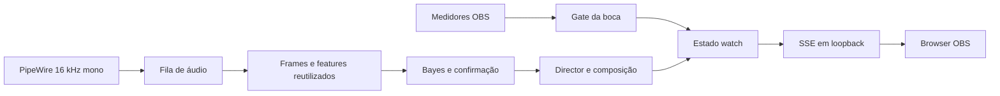

# Revisão técnica — 24/10/2026

Base: `7a51920`, com correções locais desta revisão. Skills aplicadas:
anti-ai-mediocrity, algorithmic-project-review, software-project-analysis e
ponytail (Full). Escopo: caminhos de captura/classificação, composição,
servidor SSE, imagens, persistência e integração com OBS. A leitura da UI e da
integração OBS foi parcial; não constitui auditoria completa de segurança.

O OmaTuber é um aplicativo desktop Rust/egui para animar avatares em uma fonte
browser do OBS. O caminho principal usa os medidores pós-fader do OBS; a feature
`sound` acrescenta captura PipeWire e classificação local treinável. Não há
requisito documentado de quantidade de objetos, classes ou concorrência.

Os caminhos de boca e classificação executam independentemente. Somar suas
latências seria incorreto. Tempos de rede, renderização, GPU e captura real não
foram medidos; o gargalo fim a fim permanece **UNKNOWN**. O benchmark sintético
não inclui captura, classificação Bayes, SSE nem OBS.

## Correções implementadas

| Prioridade | Evidência no código original | Efeito e correção | Verificação |
|---|---|---|---|
| Alta quando há gravações concorrentes | `src/prefs.rs::write_atomic` criava sempre `<destino>.tmp` com truncamento | Escritores podiam truncar ou renomear o temporário alheio. Cada gravação agora cria seu próprio arquivo com UUID e `create_new`, preserva sync/rename e limpa o temporário em erro | 8 escritores, 128 gravações; arquivo final integral, nenhum temporário restante; falha de rename também limpa |
| Média, contrato de limites | `src/avatar.rs::decode` ignorava `max_bytes`; o PNG estático não verificava `max_decoded_bytes` | O limite de bytes vale também para chamadas diretas; o tamanho RGBA de um canvas é verificado antes da decodificação dos pixels nos três formatos | PNG/APNG/GIF acima dos limites e PNG exatamente no limite |
| Média, correção temporal | `src/voice.rs::Listener::push` reiniciava somente o stream ao descartar áudio | O detector podia continuar uma confirmação ou um som sustentado através de áudio perdido. Agora silêncio lógico reinicia a confirmação | Som confirmado, lacuna por descarte e nova confirmação antes de sustentar |

Confiança alta nos defeitos derivados do código. As correções não adicionam
dependências ou camadas. O salvamento continua com semântica de último escritor;
não faz mesclagem de preferências de instâncias concorrentes. Temporários podem
restar se o processo for morto antes da limpeza. O orçamento das imagens limita
RGBA retido, não todo o pico de memória interno dos codecs.

A criação exclusiva usa a garantia documentada de operação atômica de
[`OpenOptions::create_new`](https://doc.rust-lang.org/std/fs/struct.OpenOptions.html#method.create_new)
(consultada em 24/10/2026). UUID já era dependência do projeto.

## Custos derivados

Variáveis: `s` sentimentos, `o` objetos, `a` referências de objetos no sentimento,
`t` objetos alternados, `f` frames da animação, `p` pixels por canvas, `b` bytes
comprimidos, `k` classes, `d` features, `c` clips e `w` janelas no conjunto de treino.

| Operação | Tempo | Memória auxiliar/retida | Base |
|---|---|---|---|
| Medidor | O(canais) | O(1) | `meter::level_db`; ignora dados não finitos |
| Composição | O(s + o × (log(t+1) + a)) | O(a + o) no pior caso | `library::Director::compose`; BTreeSet e busca linear nas referências |
| Publicação de objetos | O(o²) no pior caso, além da composição | O(o) mais erros clonados | `reactions::publish` busca cada objeto novamente por UUID |
| Decodificação | Dependente do codec, saída RGBA Θ(f × p) | O(b + f × p), sem contar temporários do codec | `avatar::decode/collect`; limites por arquivo, não globais |
| Seleção de frame | O(f) | O(f) em `Png::frame_at`; O(1) em `frame_index` | Vetor de delays e soma/varredura; máximo padrão de 600 frames |
| Bayes por janela | O(k × d) | O(k) | `sound::Model::posteriors` |
| Leave-one-clip-out | O(c × (w + k) × d + k²) | O(w × d + k × d + k²) | `sound::leave_one_out` copia e retreina por clip; matriz de confusão k² |

FFT, filtros mel e busca de pitch têm dimensões fixas nesta implementação.
`Stream` reaproveita frames entre janelas; não recalcula uma janela inteira a
cada hop. Com chunks pequenos, a memória interna de análise é limitada pelo
canvas temporal; isso não limita a fila externa de captura.

## Pendências justificadas

1. **Alta sob sobrecarga sustentada — fila de captura sem limite.**
   `capture::start` usa `std::sync::mpsc::channel`, e `voice::listen` consome um
   chunk por vez. O descarte em `Listener::push` só observa o buffer interno e o
   chunk recebido; não enxerga o áudio acumulado na fila. Logo não garante a
   promessa de tempo real. Próxima mudança: definir uma capacidade em amostras,
   descartar os dados mais antigos sem bloquear o callback PipeWire e comunicar
   a lacuna ao detector. Validar com produtor mais rápido que consumidor,
   timestamp/idade do áudio e desligamento; não trocar por `sync_channel.send`
   bloqueante no callback. A taxa real de acúmulo ainda não foi medida.
2. **Média — validação estrutural de modelos.** `Model::from_json` verifica
   somente `n_features`. Um JSON sintaticamente válido pode ter classes, médias
   e variâncias com dimensões incompatíveis, variâncias inválidas ou temperatura
   zero. Rejeitar na carga, antes do listener, com erro explicável. Impacto:
   modelo local editado ou corrompido; não há evidência de exploração remota.
3. **Baixa até haver medição — buscas repetidas e seleção de frame.**
   Os custos acima são reais, mas não demonstram lentidão no uso atual. Medir com
   bibliotecas e animações reais antes de criar índices permanentes, caches ou
   busca binária. Preservar ordem de desenho, desempate e invalidação se isso
   vier a mudar.

O README contém apenas o título. Instruções de execução, habilitação de `sound`
e conexão ao OBS ajudariam instalação, mas não foram transformadas em uma
reescrita de documentação nesta rodada de correções.

## Decisões a preservar e lentes de engenharia

- Carmack: preservar reutilização de features, publicação só quando há mudança
  e bytes compartilhados por `Arc`; medir antes de otimizar FFT ou GPU.
- Torvalds: estado do Director explícito e UUIDs estáveis tornam os invariantes
  revisáveis; o reset do detector restaura a continuidade temporal exigida.
- DHH e Thompson: as correções locais resolvem falhas sem framework, serviço novo
  ou troca do classificador. A representação simples da biblioteca permanece.
- Ritchie: servidor em loopback e rotas de assets registrados mantêm mecanismos
  pequenos; a UI não precisa conhecer detalhes do transporte SSE.

Há uma tensão entre indexar a biblioteca para reduzir buscas e manter uma única
representação simples. Sem escala documentada ou perfil que mostre custo
relevante, escolhemos a representação atual. Não há medição para calcular ganho
fim a fim por Amdahl ou afirmar qual seria o próximo gargalo.

Diagnóstico: **adequado, com correções de confiabilidade e necessidade de medição**.
As próximas prioridades são integridade temporal da fila, validação de modelos
e perfil de uma sessão real; paralelismo adicional e mudanças de arquitetura
não têm justificativa nesta revisão.

## Validação executada

- `cargo test --all-features --tests --quiet`: **184 testes aprovados, 2
  ignorados, 0 falhas**. Inclui testes de biblioteca e integração. Os ignorados
  são testes existentes; não foram ativados nesta revisão.
- `git diff --check`: sem erros.
- `cargo clippy --lib --all-features --quiet -- -D warnings`: aprovado.
- `cargo run --features sound --example bench_sound --quiet`: sinal sintético
  de 60 segundos, menor tempo de 9 execuções, perfil dev otimizado do projeto.
  Intel i5-1135G7, x86_64, rustc 1.99.1. Standalone: **4,241 ms/janela** com hop
  de 250 ms; stream: **0,427 ms/janela** com hop de 50 ms. Razões tempo/hop:
  **1,70% e 0,85%** de um núcleo, respectivamente. São estimativas do próprio
  benchmark a partir de tempo de parede, não contadores de utilização de CPU.
  Houve compilação concorrente; mínimos não descrevem variância ou caudas de
  latência. Não houve troca de algoritmo nem comparação antes/depois: estes
  números são uma referência local, não um ganho causado pelas correções.

O analisador sintético acompanha o ritmo de entrada neste ensaio; isso não
prova latência ou estabilidade da captura em uma sessão real. Medir idade da
fila, p50/p95/p99 da análise, RSS e latência até o browser durante carga no OBS
é o próximo experimento útil. Não há evidência aqui para recomendar GPU ou
mais threads.
